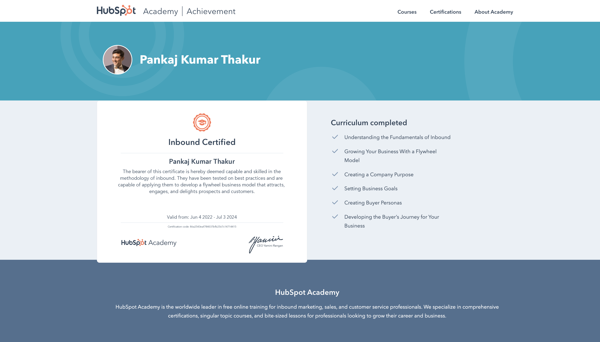
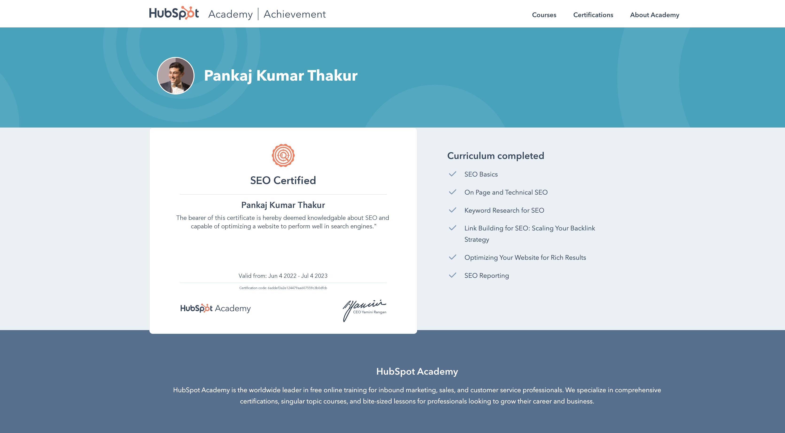

# Marketing, sales & revenue operations

**Pankaj Thakur · Skills portfolio · HubSpot Academy learning**

I bring together customer understanding, marketing execution and commercial operations. My focus is on how people discover a business, what helps them make a decision and how marketing and sales work together throughout that journey.

This portfolio organises my completed training around the skills it supports, with direct access to all 11 certificate records.

[Explore skills](#skills-at-a-glance) · [Browse certificates](#certificate-library) · [View certificate previews](#certificate-previews) · [Connect on LinkedIn](https://www.linkedin.com/in/pankajvnt/)

---

## Skills at a glance

<table>
<tr>
<td width="50%" valign="top">

### 01 / Strategy & customer understanding

Buyer personas, customer journeys, inbound planning and clear business goals. Connecting marketing activity to the questions and decisions that matter to customers.

**Learning:** Inbound · Inbound Marketing · Digital Marketing

</td>
<td width="50%" valign="top">

### 02 / Content & acquisition

Content planning, search visibility, social distribution and paid campaigns. Bringing audience needs, channel choices and messaging into a coherent acquisition approach.

**Learning:** Content Marketing · SEO · Digital Advertising · Social Media

</td>
</tr>
<tr>
<td width="50%" valign="top">

### 03 / Email & website improvement

Audience segmentation, relevant email communication, deliverability and performance analysis. Using research and continuous improvement to make websites more useful.

**Learning:** Email Marketing · Growth-Driven Design

</td>
<td width="50%" valign="top">

### 04 / Sales & revenue operations

Sales-process design, shared responsibilities, service-level agreements and systems management. Supporting teams through coaching, training and onboarding.

**Learning:** Revenue Operations · Sales Management

</td>
</tr>
</table>

## From knowledge to practical work

| Focus | What I bring to the work |
| --- | --- |
| Understand the customer | Define audiences, clarify needs and map the buying journey. |
| Plan acquisition | Connect content, search, social and advertising around an audience and a goal. |
| Improve engagement | Segment contacts and shape relevant email and content journeys. |
| Strengthen conversion | Use customer research and website improvements to reduce friction. |
| Align marketing and sales | Clarify process stages, responsibilities, handoffs and shared expectations. |
| Measure and improve | Review campaign performance, attribution and experiments to guide the next decision. |

## Certificate library

Each title opens the original certificate image stored in this repository. The skill summaries reflect the curriculum visible in those records.

| Completed training | Areas covered |
| --- | --- |
| [Revenue Operations](./Revenue%20Operations.png) | Sales-process mapping, team alignment, SLAs and systems management |
| [Sales Management](./Sales%20Management.png) | Sales coaching, training, hiring and onboarding |
| [Inbound](./Inbound.png) | Buyer personas, customer journeys and business goals |
| [Inbound Marketing](./Inbound%20Marketing.png) | Lead nurturing, segmentation, distribution and attribution |
| [Digital Marketing](./Digital%20Marketing.png) | Channel planning, website performance and campaign measurement |
| [Content Marketing](./Content%20Marketing.png) | Storytelling, editorial planning, content creation and repurposing |
| [SEO](./SEO.png) | Keyword research, on-page and technical SEO, backlinks and reporting |
| [Email Marketing](./Email%20Marketing.png) | Contact segmentation, email design, deliverability and analysis |
| [Digital Advertising](./Digital%20Advertising.png) | Audience targeting, paid-media planning, ad creative and conversion |
| [Social Media](./Social%20Media%20Marketing.png) | Social strategy, listening, content calendars and engagement |
| [Growth-Driven Design](./Growth-Driven%20Design.png) | User research, website strategy and continuous improvement |

These records document training completed in June 2022. Their displayed validity periods ended in 2023 or 2024; this portfolio records completed learning and does not claim that the credentials are currently active.

## Certificate previews

Expand a group to view the original records. Click an image to inspect it at full size.

<strong>Strategy & customer understanding · 3 records</strong>

### Inbound

### Inbound Marketing

### Digital Marketing

<strong>Content & acquisition · 4 records</strong>

### Content Marketing

### SEO

### Digital Advertising

### Social Media

<strong>Email & website improvement · 2 records</strong>

### Email Marketing

### Growth-Driven Design

<strong>Sales & revenue operations · 2 records</strong>

### Revenue Operations

### Sales Management

---

### Let's talk about the work

Interested in marketing operations, customer acquisition, lifecycle marketing or sales alignment?

[Connect with me on LinkedIn](https://www.linkedin.com/in/pankajvnt/)

Personal skills and learning portfolio. HubSpot Academy is the training provider; this repository does not imply an employment relationship, partnership or endorsement.
